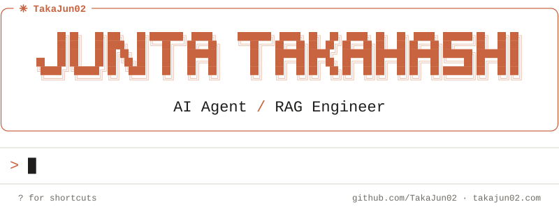

<a href="https://takajun02.com/">
  <picture>
    <source media="(prefers-color-scheme: dark)" srcset="./assets/hero-dark.svg">
    <source media="(prefers-color-scheme: light)" srcset="./assets/hero-light.svg">
    
  </picture>
</a>

### `/about`

I'm Junta, a graduate student at **Akita Prefectural University** and a software engineer focused on **LLMs, AI agents, and RAG**. 
I build AI-powered applications end to end, from agent loops and retrieval pipelines to the APIs and UIs around them. 
Professionally, I've worked on developing AI agents built on RAG. 
Most of my recent work is on agent architecture: tool calling, sub-agents, context management, and human-in-the-loop.

### `/projects`

**[Cairn](https://github.com/TakaJun02/Cairn)** — conversational trip planner for the Mt. Chokai area 
A ReAct main agent delegates to specialized sub-agents for spot recommendation, itinerary planning over real road and trail routes, and knowledge search, and asks the traveler for missing details along the way. 
`Python` `FastAPI` `Vue 3` `PostgreSQL` `pgvector` `OSRM` `vLLM`

**[Sarutahiko](https://github.com/TakaJun02/sarutahiko)** — campus guide agent for Akita Prefectural University's open campus 
A LangGraph ReAct loop chooses between vector search, keyword search, full-document retrieval, and web search, and hands campus directions off to a routing sub-agent. 
`LangGraph` `FastAPI` `Vue 3` `Qdrant` `Tavily` `PWA`

**[Hukidashi](https://github.com/TakaJun02/hukidashi)** — comic reader with LLM comment rephrasing 
Readers pin comments anywhere on a manga page, and an LLM rewrites harsh wording into a gentler tone before others see it, so the criticism stays but the sting goes. 
`FastAPI` `Vue 3` `SQLite` `vLLM`

### `/stack`

**AI / LLM** 

**Languages** 

**Backend / Frontend** 

**Databases** 

**Infrastructure / Tools** 

### `/connect`

