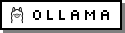
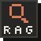
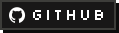
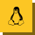
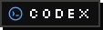

<picture>
  <source media="(prefers-color-scheme: dark)" srcset="./assets/typing-dark.svg">
  <source media="(prefers-color-scheme: light)" srcset="./assets/typing-light.svg">
  
</picture>

&nbsp;&nbsp;

Clawd (Claude Code) and the Codex mark are fan art. Not affiliated with Anthropic or OpenAI.

<h3><picture><source media="(prefers-color-scheme: dark)" srcset="./assets/h-about-dark.svg"></picture></h3>

<picture><source media="(prefers-color-scheme: dark)" srcset="./assets/mini-clawd-dark.svg"></picture>

- Graduate student at **Akita Prefectural University**
- Software engineer focused on **LLMs, AI agents, and RAG**
- Hands-on industry experience building **RAG-powered AI agents**
- Exploring agent architecture: tool calling, sub-agents, context management, human-in-the-loop

<h3><picture><source media="(prefers-color-scheme: dark)" srcset="./assets/h-stack-dark.svg"></picture></h3>

<picture><source media="(prefers-color-scheme: dark)" srcset="./assets/mini-codex-dark.svg"></picture>

#### AI / LLM

#### Languages

#### Backend / Frontend

#### Databases

#### Infrastructure / Tools

<h3><picture><source media="(prefers-color-scheme: dark)" srcset="./assets/h-activity-dark.svg"></picture></h3>

<h3><picture><source media="(prefers-color-scheme: dark)" srcset="./assets/h-connect-dark.svg"></picture></h3>

&nbsp;&nbsp;&nbsp;&nbsp;

